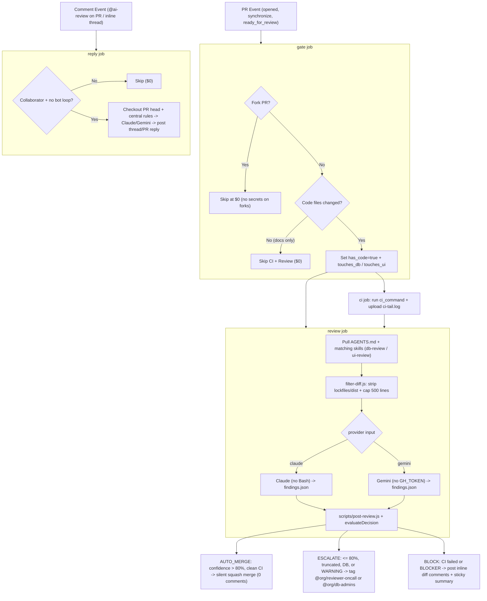

# app-central

Central reusable GitHub Actions workflow, review rules (`AGENTS.md`), domain skills, deterministic PR comment/merge scripts, and evaluation suite for model-agnostic AI PR reviews across repositories in `code-guard-demo`.

## Architecture



1. **`gate`** — Skips fork PRs and doc-only PRs (`*.md`, `*.txt`, `*.rst`, `docs/`, `LICENSE`) at $0 LLM spend. Detects `touches_db` and `touches_ui` via path regexes.
2. **`ci`** — Runs the caller's `ci_command` (e.g., `npm run lint && npm test`), captures the last 200 log lines as artifact `ci-log` (`ci-tail.log`), and passes the status (`success` / `failure`) into `review`.
3. **`review`** — Downloads central rules (`AGENTS.md`), selects matching skills (`db-review` / `ui-review`), filters out lockfiles/generated artifacts and bounds the diff (`scripts/filter-diff.js`, default `max_diff_lines: 500`), runs the selected provider (`claude` or `gemini`) in read-only mode writing `findings.json`, and hands off to `scripts/post-review.js`.
4. **3-Tier Decision Gate (`scripts/lib.js` + `scripts/post-review.js`)**:
   - **`AUTO_MERGE`**: `CI` is not failed, zero `BLOCKER` or `WARNING` findings, diff was not truncated, `touches_db == false`, and `confidence > score_threshold` (default `80%`). Squashes & merges silently (`0` comments unless updating an existing `<!-- ai-review -->` sticky comment to resolved).
   - **`ESCALATE`**: No `BLOCKER`s, but uncertain (`truncated` caps confidence at `50%`, `touches_db` at `70%`, `WARNING` at `75%`, or raw `confidence <= 80%`). Leaves the PR open, posts findings, and tags `@org/reviewer-oncall` (or `@org/db-admins` for DB changes).
   - **`BLOCK`**: `CI` failed or at least one `BLOCKER` finding exists. Posts inline review comments inside changed diff hunks and updates the sticky summary.
5. **`reply`** — Responds in-thread (`pull_request_review_comment` or `issue_comment` on a PR) when `@ai-review` is mentioned by a repository collaborator (`admin` / `write`) outside bot loops.

## Repository Layout

```text
app-central/
├── .github/workflows/reusable-review.yml   # Central reusable workflow (workflow_call)
├── AGENTS.md                               # Universal rules + strict JSON output contract
├── CLAUDE.md                               # Pointer to AGENTS.md
├── GEMINI.md                               # Pointer to AGENTS.md
├── skills/
│   ├── db-review/SKILL.md                  # SQL migrations, locking, index coverage, N+1
│   └── ui-review/SKILL.md                  # Component state, accessibility, error handling
├── scripts/
│   ├── filter-diff.js                      # Ignores lockfiles/dist/minified & bounds diff lines
│   ├── lib.js                              # Parser, diff line mapper, deterministic decision engine
│   ├── post-review.js                      # Inline comments, idempotent sticky comment, auto-merge
│   └── test/                               # Unit tests (27 tests via node --test)
└── eval/
    ├── cases.json                          # 10-case benchmark (8 seeded bugs + 2 clean diffs)
    ├── score.js                            # Precision / Recall / F1 / cost scorer
    └── run-eval.js                         # Live Claude vs Gemini ablation runner
```

## Caller Setup

In any target application repository (`.github/workflows/ai-review.yml`):

```yaml
name: AI PR Review

on:
  pull_request:
    types: [opened, synchronize, ready_for_review]
  issue_comment:
    types: [created]
  pull_request_review_comment:
    types: [created]

permissions:
  contents: write
  pull-requests: write
  issues: write

jobs:
  ai-review:
    uses: code-guard-demo/app-central/.github/workflows/reusable-review.yml@v1.2
    with:
      provider: "claude" # "claude" | "gemini"
      central_ref: "v1.2"
      ci_command: "npm run lint && npm test"
    secrets:
      ANTHROPIC_API_KEY: ${{ secrets.ANTHROPIC_API_KEY }}
      GEMINI_API_KEY: ${{ secrets.GEMINI_API_KEY }}
      SKILLS_REPO_TOKEN: ${{ secrets.SKILLS_REPO_TOKEN }}
```

### Inputs & Secrets

| Input | Default | Purpose |
|---|---|---|
| `provider` | `"claude"` | LLM provider (`"claude"` or `"gemini"`) |
| `central_ref` | `"main"` | Tag/ref of `app-central` used to fetch rules, skills, and scripts |
| `model` | `""` | Optional model override |
| `ci_command` | `""` | Stage-1 command to run before review (empty skips CI) |
| `node_version` | `"20"` | Node.js version for `ci` and `post-review.js` |
| `db_paths` | `^(db\|migrations)/\|\.sql$\|/models/\|/repositories/` | Regex triggering `db-review` skill and DB escalation cap |
| `ui_paths` | `^src/(components\|pages)/\|\.(tsx\|jsx\|vue)$` | Regex triggering `ui-review` skill |
| `db_escalation` | `"@org/db-admins"` | Tag mentioned when DB changes trigger escalation |
| `simulate_fork` | `false` | Test flag to exercise the fork skip policy |
| `max_diff_lines` | `500` | Max non-ignored diff lines passed to the LLM |
| `auto_merge` | `true` | Auto-merge via squash when `effectiveConfidence > score_threshold` |
| `score_threshold` | `80` | Minimum effective confidence (`0–100`) for silent auto-merge |
| `escalation_tag` | `"@org/reviewer-oncall"` | Tag mentioned on non-DB uncertain escalations |

Secrets: `SKILLS_REPO_TOKEN` (required read token for `app-central` if private) plus `ANTHROPIC_API_KEY` or `GEMINI_API_KEY` matching `provider`.

## Security & Access Control

- **Fork & collaborator guards:** `gate` skips fork PRs before invoking CI or LLMs (no secrets exposed), and `reply` verifies repository collaborator write/admin permissions plus bot/marker loop guards.
- **Sandboxed agents:** Claude runs with `--disallowedTools "Bash"`; Gemini runs with no `GH_TOKEN`, `GEMINI_CLI_TRUST_WORKSPACE: "true"`, and overwritten `settings` (`telemetry: false`) so PR branches cannot inject CLI config.
- **Pinned actions:** Every external GitHub Action in `reusable-review.yml` is pinned by full commit SHA.
- **Untrusted input isolation:** PR titles/comments pass through `env:` variables and `--body-file` / JSON files rather than shell interpolation, and all model output goes through `parseFindings` (marker spoofing stripped, capped at `20` findings) and deterministic `evaluateDecision` caps.

## Tests & Evaluation

Run all unit tests locally (`node` v20+):

```bash
npm test
```

Run the live 10-case provider evaluation benchmark (requires `ANTHROPIC_API_KEY` and `GEMINI_API_KEY`):

```bash
node eval/run-eval.js
```
